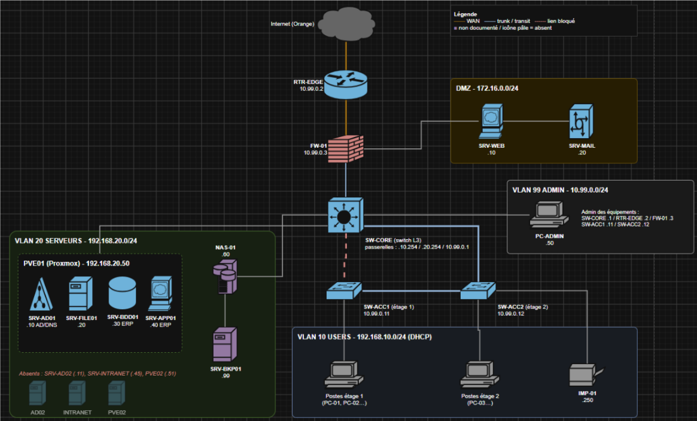
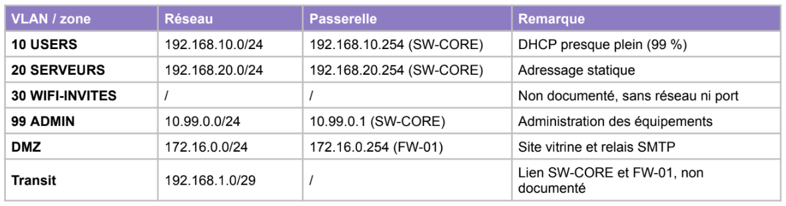
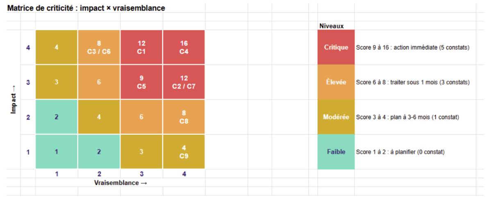
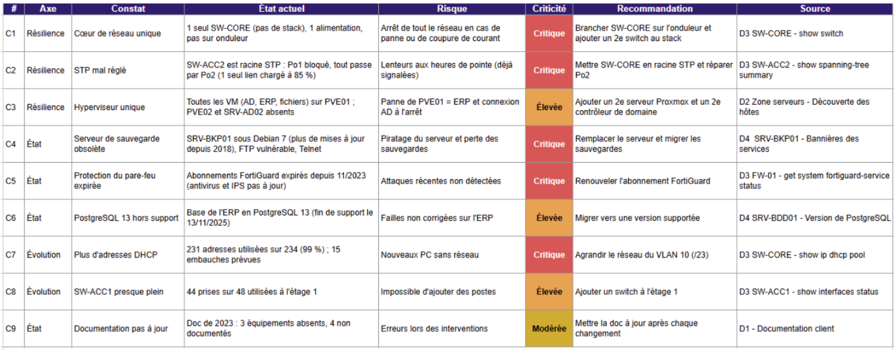

# CloudNexa Project : IT Infrastructure Audit & Network Assessment




---

## 📌 Project Overview

This project focuses on conducting a comprehensive IT infrastructure audit for CloudNexa, a fictional company with approximately 60 employees.

The objective was to assess the current state of the company's IT infrastructure, identify potential vulnerabilities and operational weaknesses, evaluate network resilience, and determine whether the existing environment could support future business growth.

The audit was based on an outdated infrastructure documentation dating from March 2023. Through network discovery, service enumeration, configuration reviews, and infrastructure analysis, the existing environment was compared against its historical documentation to identify discrepancies and undocumented assets.

The assessment covered the network architecture, switching infrastructure, VLAN segmentation, IP addressing, DHCP services, virtualization environment, backup infrastructure, perimeter security, and network scalability.

The final deliverable is a structured infrastructure audit report containing an asset inventory, logical network mapping, risk assessment, critical findings, and prioritized technical recommendations.

### Key findings :

* 19 infrastructure elements inventoried.
* 3 assets documented but absent or unreachable.
* 4 previously undocumented infrastructure elements identified.
* 9 findings identified: 5 critical, 3 high, and 1 moderate.
* Several weaknesses affecting network availability, backup security, perimeter protection, and infrastructure scalability.


---

## 🎯 Objectives

The project was designed around three main assessment areas: infrastructure health, operational resilience, and future scalability.


### Infrastructure Assessment :

* Identify active devices, servers, and network components.
* Compare the actual infrastructure against the 2023 documentation.
* Identify undocumented equipment and discrepancies.
* Review the existing network topology and IP addressing scheme.
* Analyze the configuration of switches, routers, firewalls, and network services.


### Network Analysis :

* Discover active hosts across authorized network segments.
* Identify exposed services and listening ports.
* Analyze VLAN segmentation and inter-VLAN routing.
* Review Spanning Tree Protocol (STP) configuration.
* xamine EtherChannel and Link Aggregation Control Protocol (LACP) configurations.
* Investigate potential network bottlenecks and single points of failure.


### Security Assessment :

* Identify outdated operating systems and vulnerable services.
* Evaluate the security status of the backup infrastructure.
* Review firewall subscription status and perimeter protection.
* Identify unnecessary or insecure network services.
* Assess the potential impact of identified weaknesses.


### Resilience and Scalability :

* Identify single points of failure.
* Evaluate the availability of network and virtualization components.
* Assess DHCP address pool capacity.
* Evaluate physical network connectivity and available ports.
* Determine whether the infrastructure can accommodate 15 additional employees planned for early 2027.


### Recommendations :

* Prioritize corrective actions according to risk severity.
* Propose immediate security and configuration improvements.
* Define a medium-term infrastructure modernization plan.
* Establish a long-term strategy for redundancy, high availability, and monitoring.


---

## 🏗️ Infrastructure Overview

The audited infrastructure represents a small-to-medium enterprise environment composed of network equipment, virtualization hosts, servers, storage, and perimeter security components.

The infrastructure is organized into several logical network segments.


### 1. Network Architecture

The network architecture includes the following components :

Internet Connectivity

* Orange Fiber connection.
* RTR-EDGE: Edge router.
* FW-01: FortiGate firewall providing perimeter security.
* No operational 4G backup connection was identified.

Core Network

* SW-CORE: Cisco Catalyst 9300 core switch.
* Inter-VLAN routing.
* DHCP services for the user network.
* Connectivity between the core network and the firewall.
* A single core switch represents a major single point of failure.

Access Layer

* SW-ACC1: Access switch located on the first floor.
* SW-ACC2: Cisco Catalyst 2960-S access switch located on the second floor.
* Inter-switch connectivity using EtherChannel.
* STP configuration requiring correction.

Server Infrastructure

* PVE01: Proxmox virtualization host.
* NAS-01: Network Attached Storage.
* SRV-BKP01: Backup server running Debian 7.
* SRV-AD01: Active Directory domain controller.
* PostgreSQL database services.
* Additional services hosted in the server environment.

DMZ

* Dedicated network segment for externally exposed services.
* SRV-WEB: Web server.
* SRV-MAIL: SMTP relay.

The physical connection of the DMZ servers could not be fully verified during the assessment.


### 2. VLAN and IP Addressing

The following network segments were identified :



The user network was found to be operating at approximately 99% DHCP utilization, leaving very limited capacity for additional devices.


### 3. Main Infrastructure Components

|      Component      |               Role                |               Assessment               |
| ------------------- | --------------------------------- | -------------------------------------- |
|    SW-CORE          |    Core switching and routing     |    Single point of failure             |
|    SW-ACC1          |    Access switching               |    Requires capacity expansion         |
|    SW-ACC2          |    Access switching               |    Older hardware and STP issues       |
|    FW-01            |    Perimeter firewall             |    Expired security subscriptions      |
|    RTR-EDGE         |    Internet edge routing          |    No identified 4G backup             |
|    PVE01            |    Virtualization host            |    No second cluster node              |
|    NAS-01           |    Network storage                |    Previously undocumented             |
|    SRV-BKP01        |    Backup server                  |    Obsolete Debian 7 environment       |
|    SRV-AD01         |    Active Directory               |    Second controller absent            |
|    SRV-WEB          |    Web services                   |    Located in DMZ                      |
|    SRV-MAIL         |    SMTP relay                     |    Located in DMZ                      |


---

## 🔎 Audit Methodology

The assessment followed a structured and non-intrusive audit methodology.

All activities were performed within the authorized scope defined in the audit mission.


### 1. Network Discovery

Nmap was used to identify active hosts and discover exposed services across the authorized network segments.

Main techniques :

* Host discovery using -sn.
```
nmap -sn 192.168.10.0/24 10.99.0.0/24 172.16.0.0/24
```
* TCP SYN scanning using -sS.
```
nmap -sS --top-ports 1000 -T4 -iL hotes_zones.txt
```
* Service and version detection using -sV.
```
nmap -sS -sV --top-ports 1000 -T4 -iL hotes_zones.txt
```
* Operating system detection using -O.
```
nmap -sS -sV -O --top-ports 1000 -T4 -iL cibles.txt
```
* UDP service discovery using -sU.
```
nmap -sU -sV -p 161 192.168.10.250 10.99.0.1,2,11,12
```
* Targeted port scanning for specific services.
```
nmap -sS -sV -Pn -p 25,587 172.16.0.20
nmap -sS -sV -p 8006 192.168.20.50
```


### 2. Network Configuration Review

Network equipment was accessed through SSH using read-only credentials on the five identified network devices.

The objective was to examine network configurations, identify topology inconsistencies, and assess the overall switching architecture.

Main commands and configuration checks:

* Device software and hardware information.
```
show version
```
* Network neighbor discovery using CDP/LLDP.
```
show cdp neighbors
show lldp neighbors
```
* VLAN configuration review.
```
show vlan brief
```
* Trunk interface verification.
```
show interfaces trunk
```
* Spanning Tree Protocol analysis.
```
show spanning-tree root
```
* EtherChannel and LACP status verification.
```
show etherchannel summary
```
* DHCP pool utilization analysis.
```
show ip dhcp pool
```


### 3. Server and Service Assessment

Several tools and protocols were used to inspect server infrastructure, identify exposed services, and assess the status of critical systems.

Main tools :

* PostgreSQL (psql) : Database connectivity and configuration inspection.
* SMB (smbclient) : File-sharing service inspection.
* DNS (dig) : DNS records and name resolution analysis.
* HTTP/HTTPS (curl) : Web service inspection.
* TLS (openssl) : Certificate and encryption inspection.
* SNMP (snmpget) : Network and server information retrieval.

The assessment focused on identifying outdated software, legacy services, undocumented systems, and potential security weaknesses.


### 4. Risk Assessment

Each identified finding was evaluated using an impact × likelihood methodology.

Both impact and likelihood were rated on a scale from 1 to 4.

The resulting score was used to classify findings according to their severity.



This classification provided a consistent framework for prioritizing remediation actions according to their potential impact on infrastructure security, availability, and scalability.


---

## 🗺️ Key Findings and Security Risks

After identifying the infrastructure components, the next step was to reconstruct the logical network topology.

The audit identified nine findings affecting infrastructure availability, security, resilience, and scalability.



### 1. Critical Findings

The infrastructure is organized around a central Cisco switch responsible for inter-VLAN routing and DHCP services.

C1 : Single Point of Failure in the Core Network

* The entire network relies on a single core switch, SW-CORE, which is not connected to the UPS.
* A previous power outage in 2025 caused a complete network interruption.
* The absence of core redundancy creates a major availability risk.

C2 : Incorrect Spanning Tree and EtherChannel Configuration

* The STP root bridge is incorrectly positioned on SW-ACC2.
* Additionally, the EtherChannel configuration contains inconsistencies, resulting in a blocked link and inefficient traffic distribution.
* Traffic from the floors is concentrated on a single 1 Gbps link, contributing to reported network performance issues.

C3 : Insufficient Infrastructure Redundancy

* The virtualization environment relies on a single Proxmox host, PVE01.
* The documented second virtualization host, PVE02, is absent.
* The second Active Directory domain controller, SRV-AD02, is also unavailable.
* This creates dependencies on individual systems and increases the risk of service interruption.

C4 : Obsolete and Vulnerable Backup Server

SRV-BKP01 runs Debian 7 and exposes several outdated services:
* FTP –-> Port 21.
* SSH –-> Port 22.
* Telnet –-> Port 23.
* MySQL –-> Port 3306.

The obsolete operating system and legacy services increase the risk of unauthorized access and compromise of backup infrastructure.

C5 : Expired Firewall Security Subscriptions

* The FortiGuard security subscription associated with FW-01 expired on November 30, 2023.
* The security definitions identified during the audit date from December 1, 2015.
* This represents a significant weakness in perimeter protection.


### 2. High-Severity Findings

C6 : Outdated PostgreSQL Version

The database environment requires migration to a supported PostgreSQL version to improve security, compatibility, and maintainability.

C7 : DHCP Address Pool Almost Exhausted

The user DHCP pool has 231 leased addresses out of 254 total addresses, with 20 excluded addresses.
The available address capacity is insufficiently prepared for future workforce expansion.

C8 : Insufficient Physical Network Capacity

Only four available network ports were identified on the first floor, while 15 additional employees are expected in early 2027.
Additional switching capacity is required.


### 3. Moderate Finding

C9 : Outdated Infrastructure Documentation

The existing documentation dates from March 2023 and contains several discrepancies.

Examples include:
* Missing network equipment.
* Incorrect switch model information.
* Missing virtualization infrastructure.
* Undocumented network segments.
* Missing backup and storage components.

Maintaining accurate infrastructure documentation is essential for operational continuity and incident response.


---

## 🔀 Recommendations and Remediation Roadmap

The recommendations were organized into three implementation phases.


### Phase 1 : Immediate Actions (Under 1 Month)

Priority : Reduce immediate security and availability risks.

|                        Action                       |                        Objective                         |
| --------------------------------------------------- | -------------------------------------------------------- |
|    Connect SW-CORE to the UPS                       |    Protect the core network against power interruptions  |
|    Correct STP root bridge placement                |    Restore a consistent spanning-tree topology           |
|    Restore the correct EtherChannel configuration   |    Improve link utilization and network resilience       |
|    Isolate SRV-BKP01                                |    Reduce exposure of obsolete services                  |
|    Disable Telnet and FTP                           |    Remove insecure legacy access methods                 |
|    Renew FortiGuard subscriptions                   |    Restore current security definitions                  |
|    Optimize DHCP leases                             |    Recover available IP addresses                        |


### Phase 2 : Medium-Term Improvements (Under 3 Months)

Priority: Modernize the infrastructure and prepare for business growth.

|                          Action                           |                Objective                 |
| --------------------------------------------------------- | ---------------------------------------- |
|    Expand the user network to /23 or segment it by floor  |    Increase addressing capacity          |
|    Replace SRV-BKP01                                      |    Deploy a supported backup solution    |
|    Test backup restoration                                |    Validate recovery capabilities        |
|    Migrate PostgreSQL                                     |    Use a supported database version      |
|    Install an additional access switch                    |    Accommodate new employees             |
|    Restore a second domain controller                     |    Improve Active Directory resilience   |
|    Update infrastructure documentation                    |    Maintain accurate technical records   |


### Phase 3 : Long-Term Improvements (Under 12 Months)

Priority : Improve high availability and infrastructure resilience.

|                      Action                       |                      Objective                       |
| ------------------------------------------------- | ---------------------------------------------------- |
|    Add a second Catalyst 9300 to the core stack   |    Improve core network redundancy                   |
|    Add a second power supply                      |    Improve power resilience                          |
|    Deploy a second Proxmox node                   |    Enable virtualization cluster high availability   |
|    Replace SW-ACC2                                |    Modernize access-layer equipment                  |
|    Implement backup Internet connectivity         |    Improve WAN availability                          |
|    Deploy a second firewall                       |    Strengthen perimeter redundancy                   |
|    Implement infrastructure monitoring            |    Improve operational visibility                    |


---

## 🧰 Technologies & Tools

The following technologies and tools were used during the assessment.

### Network Discovery and Analysis

* Nmap 7.93 : Network discovery, port scanning, service enumeration, and operating system detection.
* SNMP : Network device information retrieval.
* CDP / LLDP : Network topology and neighbor discovery.
* Spanning Tree Protocol (STP) : Layer 2 loop prevention and topology analysis.
* EtherChannel / LACP : Link aggregation configuration analysis.
* VLANs : Network segmentation and logical architecture analysis.

### Network Infrastructure

* Cisco Catalyst 9300.
* Cisco Catalyst 2960-S.
* FortiGate firewall.
* Proxmox VE.
* DHCP.
* DNS.
* TCP/IP networking.

### Server and Service Assessment

* Debian Linux.
* PostgreSQL.
* MySQL.
* Active Directory.
* SMB.
* FTP / SSH / Telnet.
* SMTP.
* HTTP / HTTPS.

### Administration and Documentation

* SSH : Secure remote administration.
* psql : PostgreSQL inspection.
* smbclient : SMB service inspection.
* dig : DNS queries.
* curl : HTTP/HTTPS inspection.
* openssl : TLS inspection.
* snmpget : SNMP information retrieval.
* draw.io : Network topology modeling.
* Spreadsheet tools : Asset inventory and risk assessment.


---

## 📚 Skills Demonstrated

This project demonstrates practical knowledge and technical skills in several IT infrastructure domains.

### Network Administration

* Network architecture analysis.
* VLAN segmentation.
* IP addressing and subnetting.
* DHCP management.
* Inter-VLAN routing.
* STP analysis.
* EtherChannel and LACP troubleshooting.
* Network topology mapping.

### Systems Administration

* Linux server assessment.
* Windows infrastructure and Active Directory analysis.
* Virtualization infrastructure assessment.
* Database service inspection.
* Backup infrastructure evaluation.
* Remote administration through SSH.

### Cybersecurity

* Network reconnaissance.
* Service enumeration.
* Vulnerability and exposure identification.
* Infrastructure risk assessment.
* Security configuration review.
* Legacy service identification.
* Perimeter security assessment.
* Remediation prioritization.

### Infrastructure Engineering

* High availability planning.
* Single point of failure identification.
* Network capacity planning.
* Infrastructure scalability assessment.
* Backup and disaster recovery planning.
* Technical documentation.

### Technical Reporting

* Infrastructure inventory.
* Network topology documentation.
* Risk matrices.
* Technical findings documentation.
* Remediation roadmap development.
* Executive-level reporting.


---

## 📁 Repository Structure

```text
.
├── README.md
└── Images/
    ├── Plan_adressage.png
    ├── Schéma_réseau.png
    ├── Tableau_constats.png
    └── Tableau_criticité.png
```

Note: This is a proposed repository organization. The actual contents should reflect the files included in the GitHub repository.


---

## ✅ Results

The infrastructure audit successfully established a technical overview of the CloudNexa IT environment and identified several areas requiring corrective action.

### Audit Results

|                  Metric                   |  Result  |
| ----------------------------------------- | -------- |
|    Infrastructure elements inventoried    |    19    |
|    Compliant elements                     |    8     |
|    Modified elements                      |    5     |
|    Undocumented elements                  |    4     |
|    Missing or unavailable elements        |    3     |
|    Total findings                         |    9     |
|    Critical findings                      |    5     |
|    High findings                          |    3     |
|    Moderate findings                      |    1     |

### Main Outcomes

* Identified critical network availability weaknesses.
* Detected incorrect STP and EtherChannel configurations.
* Identified outdated server software and insecure legacy services.
* Discovered expired firewall security subscriptions.
* Evaluated backup infrastructure weaknesses.
* Identified missing redundancy in virtualization and Active Directory.
* Detected DHCP address exhaustion risks.
* Evaluated physical network capacity for future recruitment.
* Established a prioritized infrastructure remediation roadmap.

Important: This project produced an audit report and remediation recommendations. The proposed corrective actions are not presented as completed implementations. Their effectiveness would need to be validated through a subsequent remediation and verification phase.


---

## 🎓 Context

Academic project : Bachelor 3 Cybersecurity

This project was completed during the 2026–2027 academic year as part of an infrastructure auditing and cybersecurity assignment.

It allowed me to apply practical network discovery, infrastructure analysis, system administration, and risk assessment techniques in an enterprise environment.


---

## 👤 Author

Sonia LOPEZ

Bachelor's Degree : Cybersecurity


---

## 📌 Key Takeaways

This project helped me understand that securing an enterprise infrastructure involves much more than configuring firewalls or protecting individual servers.

It requires a global understanding of how network devices, servers, services, backups, and security mechanisms interact.

Through this audit, I was able to identify weaknesses, understand their potential impact on business operations, and propose realistic improvements based on technical priorities.
